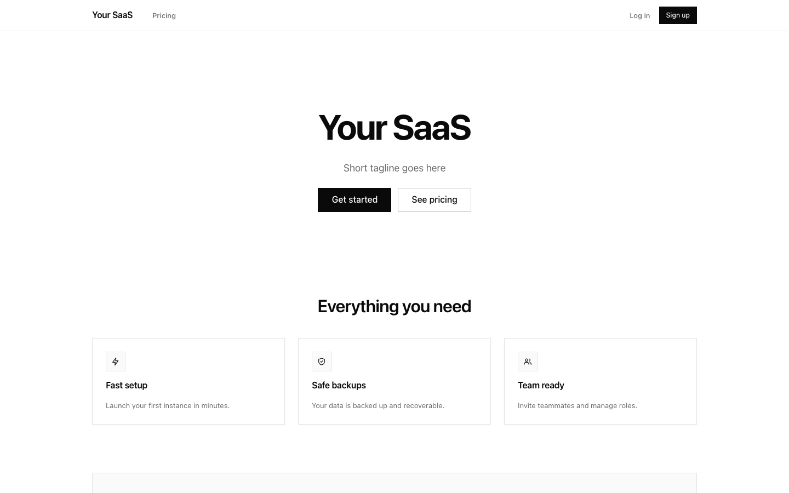
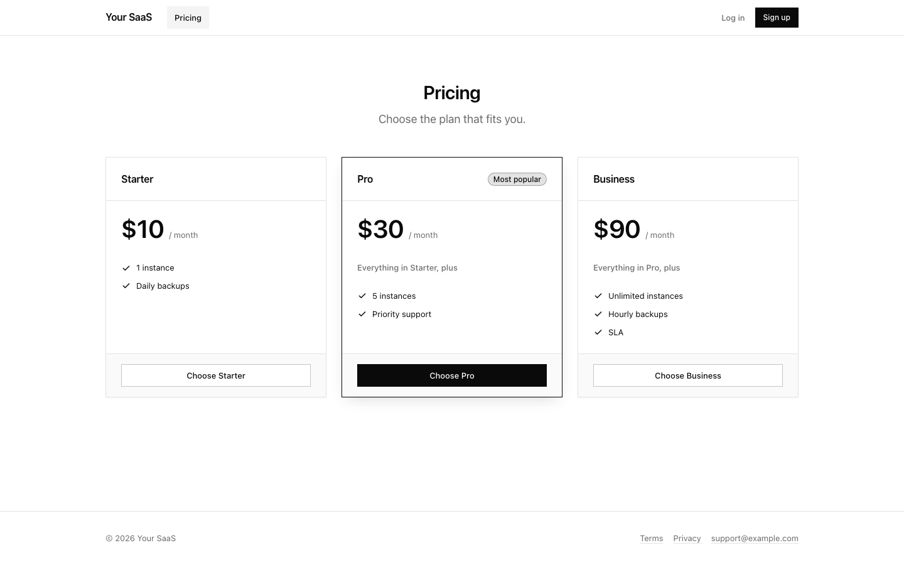
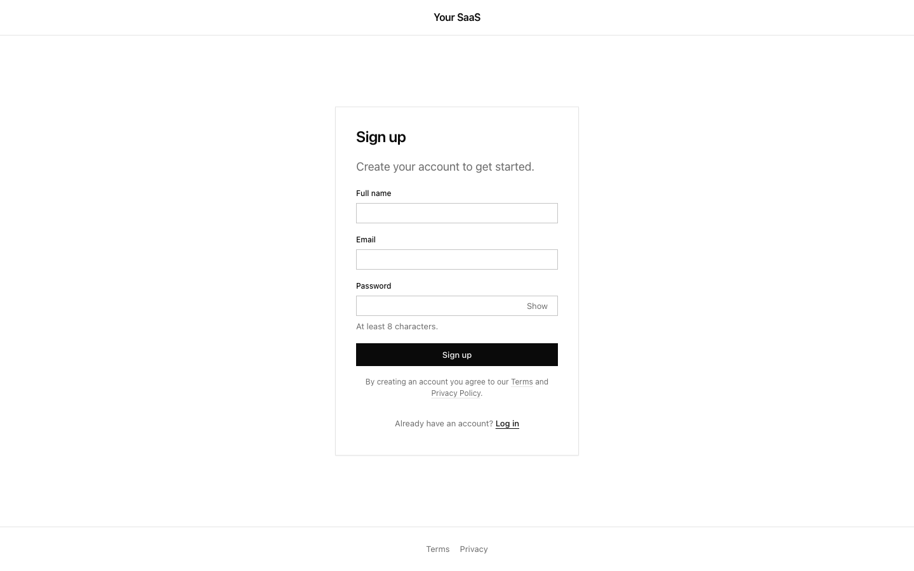
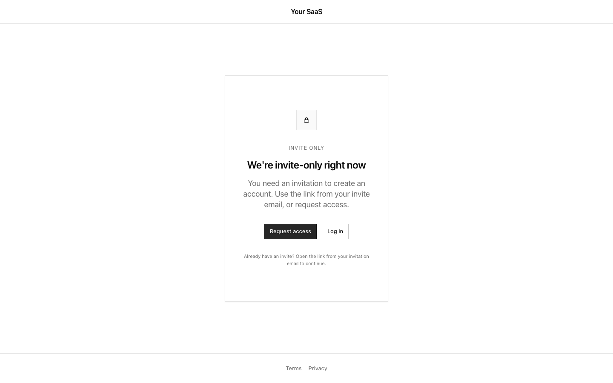
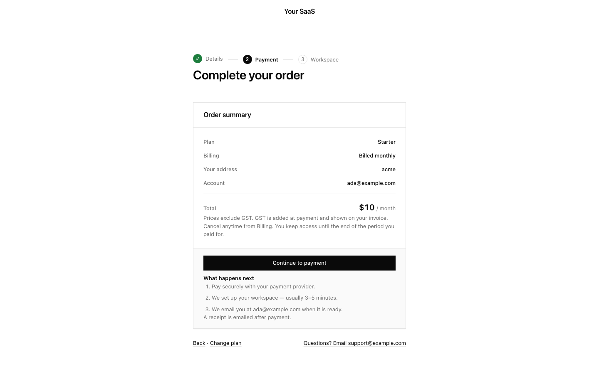
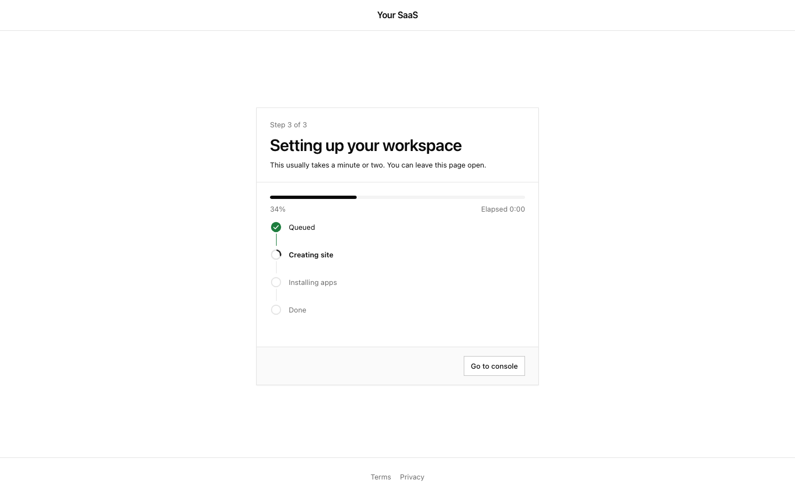
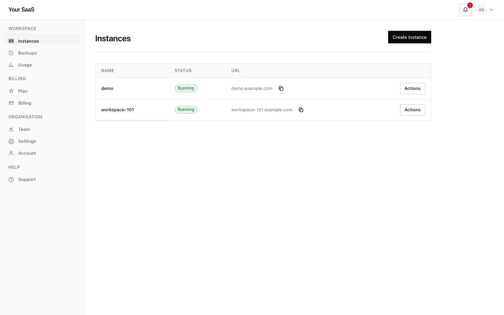
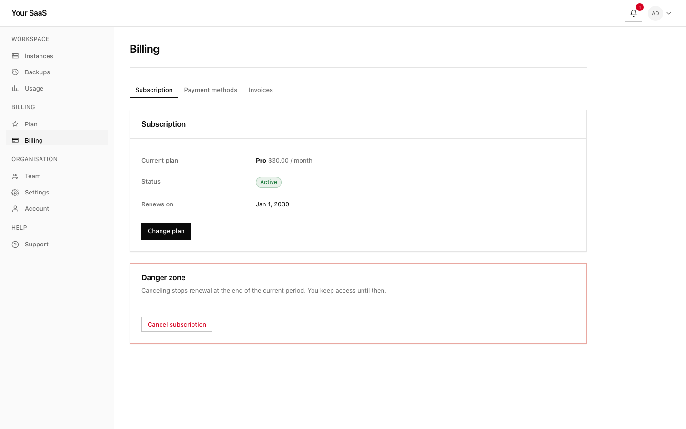

# Frappe SaaS Kit Starter

`frappe-saaskit-starter`

[](https://github.com/tridz-open/frappe-saaskit-starter/actions/workflows/ci.yml)

Launch your Frappe app as SaaS product with Frappe Cloud handling the had parts. It is the customer-facing site and console you put in front of your app when you sell it as a subscription, with each tenant hosted on Frappe Cloud and the whole thing backed by the [`saas_core`](https://github.com/tridz-open/saas_core) control plane. It is not a generic SaaS template.

Built with Vite, React 19 and TypeScript, it ships the pages that selling a Frappe app as SaaS needs: landing, pricing, signup/login/password reset, onboarding, checkout, provisioning progress, and a customer console (instances, backups, plan, billing, invoices, team, account, support).

The stack:

- [`saas_core`](https://github.com/tridz-open/saas_core): the Frappe control-plane app that owns plans, subscriptions, billing and tenant provisioning on Frappe Cloud.
- [`frappe-saaskit-sdk`](https://github.com/tridz-open/frappe-saaskit-sdk): the TypeScript SDK (`@frappe-saaskit/client` and `@frappe-saaskit/react`) this front end uses to talk to `saas_core`.
- This repo: the front end (landing to customer console) you fork and brand for your product.

It runs in two modes:

- **Fixture mode** (default): in-memory demo data, no backend. Good for trying the UI and building pages.
- **Live mode** (`VITE_DATA_ADAPTER=saaskit`): talks to a Frappe site running `saas_core` through the SDK. The SDK is installed from the vendored tarballs in `vendor/saaskit` until it is published to npm.

## Status: alpha

### Experimental features

These are in the alpha but have not been verified against a live `saas_core` (fixture or mock-tested only). Their page headers carry an "Experimental" badge:

- Team invites and roles (`/console/team`, accept invite)
- API tokens (Account page)
- Support tickets
- Invoice PDF
- Password reset (forgot and reset pages)
- Admin pages (admin tenants, beta access)


This is an early release. Expect breaking changes to the extension API (`createSaasApp`), the data hooks and the CSS tokens.

What works:

- All pages render and are navigable in fixture mode, including scenarios for invite-only signup, an empty account, a past-due subscription and a failed provisioning job.
- The Playwright suite (17 tests, fixture mode) passes.
- Live mode is wired to the SDK for auth, plans, checkout (Razorpay Checkout.js or a hosted-gateway redirect), provisioning progress, instances, backups and restore requests, invoices, team, profile/password and support tickets. This repo has no automated tests for live mode; it has been exercised manually against `saas_core` only.

What does not work yet, or has known gaps:

- **Live mode and the SDK install.** The SDK is not on npm yet; see [Install the SDK for live mode](#install-the-sdk-for-live-mode). Fixture mode does not need it.
- In live mode, sessions, notifications and cancel-deletion are hidden, as is backup download (the download link returned 500 live without offsite backup config). Actions the live API does not support (removal approval, session revoke, mark notification read) throw a "not supported" error instead of silently succeeding (`useCapabilities()`), because `saas_core` has no endpoints for them yet. Saved payment methods are not listed; the page links to the gateway portal instead.
- Terms and Privacy pages are templates with a visible banner. Replace them with your own text via `site.copy` before going live.
- In fixture mode the invoice download serves a bundled sample PDF; in live mode it links to `saas_core.api.v1.invoices.pdf`.
- Unit tests: 61 vitest tests in 12 files cover the data layer, i18n, live mappers, admin pages and a few components. There are no automated tests for live mode, which has been exercised manually against `saas_core`.
- Depends on pre-release packages: `@ui-sdk/*` 0.1.0 betas, TypeScript 7, Vite 8.

## Screenshots

Captured at 1440x900 from fixture mode (`npm run dev`, no backend). Full set, including mobile (390 px) shots: [docs/screenshots/](docs/screenshots/).

| | |
|---|---|
| <br>Landing page with the neutral, rebrandable placeholder copy. | <br>Pricing with three plans and a highlighted popular tier. |
| <br>Signup form. | <br>Invite-only state (`?scenario=invite_only`) shown when signup needs an invitation. |
| <br>Checkout order summary before handing off to the payment provider. | <br>Provisioning in progress, with per-step status. |
| <br>Console instances list with status and URL. | <br>Billing: subscription, payment methods and invoices. |

## Prerequisites

| Tool | Version | Why |
|---|---|---|
| Node.js | 20.19+ or 22.12+ | Vite 8 |
| npm | 10+ | this repo |
| git | any | cloning |

For live mode you also need a Frappe v16 bench with `saas_core` installed (see the [`saas_core` README](https://github.com/tridz-open/saas_core)).

## Quickstart (fixture mode, no backend, no SDK)

```bash
git clone https://github.com/tridz-open/frappe-saaskit-starter.git && cd frappe-saaskit-starter
npm install && npm run dev
```

Open http://localhost:5173. If `npm install` cannot fetch the SDK (see below) fixture mode still works: the live adapter is loaded lazily and is never bundled in fixture builds.

## Install the SDK for live mode

The SDK ([frappe-saaskit-sdk](https://github.com/tridz-open/frappe-saaskit-sdk)) is distributed as GitHub release tarballs until the `@frappe-saaskit` npm scope is registered. Versions are lock-stepped, so bump both URLs together.

**Primary (public release):** in `package.json`, point both packages at the release assets and pin the inner client with an override (npm `overrides`; the react tarball depends on the client by exact version):

```json
"dependencies": {
  "@frappe-saaskit/client": "https://github.com/tridz-open/frappe-saaskit-sdk/releases/download/v0.1.0-alpha.3/frappe-saaskit-client-0.1.0-alpha.3.tgz",
  "@frappe-saaskit/react": "https://github.com/tridz-open/frappe-saaskit-sdk/releases/download/v0.1.0-alpha.3/frappe-saaskit-react-0.1.0-alpha.3.tgz"
},
"overrides": {
  "@frappe-saaskit/client": "https://github.com/tridz-open/frappe-saaskit-sdk/releases/download/v0.1.0-alpha.3/frappe-saaskit-client-0.1.0-alpha.3.tgz"
}
```

**Use SDK `0.1.0-alpha.3`.** Download the two `.tgz` assets from the [frappe-saaskit-sdk releases](https://github.com/tridz-open/frappe-saaskit-sdk/releases) (tag `v0.1.0-alpha.3`) and use the release URLs above, or save them in `vendor/saaskit/` and use `file:` specs with the same override block, for example `"@frappe-saaskit/client": "file:vendor/saaskit/frappe-saaskit-client-0.1.0-alpha.3.tgz"`.

**Known mismatch:** `package.json` and `vendor/saaskit/` in this checkout still point at the `0.1.0-alpha.1` tarballs; they have not been re-vendored to alpha.3 yet. The live adapter reads `Me.email_verified`, which the alpha.1 types do not declare (see `src/data/liveMapping.ts`). The SDK is only needed for live mode and for `npm run typecheck`; fixture mode does not use it.

## Run in fixture mode (no backend)

`npm run dev`, then open http://localhost:5173. Log in with any email and password; nothing is sent anywhere. Fixture data lives in memory and resets on a full page reload (the signed-in user is kept in `sessionStorage`).

Switch scenario with a query string, which sticks for the browser tab:

| URL | Shows |
|---|---|
| `/?scenario=default` | normal account with two instances |
| `/signup?scenario=invite_only` | signup that requires an invitation |
| `/console?scenario=empty` | new account with no instances |
| `/console/billing?scenario=past_due` | past-due subscription banner |
| `/console?scenario=provision_failed` | provisioning that fails |

Or set `VITE_FIXTURE_SCENARIO=<name>` for the whole dev session.

## Run against a real saas_core (live mode)

1. Install `saas_core` on a Frappe site and create at least one plan (see the [`saas_core` README](https://github.com/tridz-open/saas_core)), and install the SDK (above).
2. Copy the env file and edit it:

   ```bash
   cp .env.example .env.local
   # VITE_DATA_ADAPTER=saaskit
   # SAAS_BACKEND_URL=http://site.localhost:8000   # your Frappe site
   ```

3. `npm run dev`. `vite.config.ts` proxies `/api` and `/files` to `SAAS_BACKEND_URL` so cookie auth is same-origin, and dedupes React / react-query so the SDK shares the app's copies. The API base defaults to the same origin, so requests go to `/api/method/saas_core.api.v1.*`.

### Production deploy

Cookie auth needs the app and the API on the **same origin**. Build with `VITE_DATA_ADAPTER=saaskit npm run build` and serve `dist/` from the same domain as the Frappe site (for example behind the Frappe nginx, or a reverse proxy that forwards `/api` and `/files` to Frappe and everything else to `dist/` with an SPA fallback to `index.html`). `npm run preview` uses the same proxy settings for a local check. To call a different origin, set `VITE_SAAS_API_URL` and handle CORS and cookie `SameSite`/domain on the Frappe side.

### Environment variables

| Variable | Default | Meaning |
|---|---|---|
| `VITE_DATA_ADAPTER` | fixtures when unset | `saaskit` switches to the live SDK adapter. Note: `.env.example` sets it to `saaskit`, so `cp .env.example .env.local` enables live mode; remove or change the line for fixture mode |
| `VITE_SAAS_API_URL` | `''` (same origin) | Frappe site origin if different from the app |
| `SAAS_BACKEND_URL` | `http://localhost:8000` | dev/preview proxy target (not bundled) |
| `VITE_FIXTURE_SCENARIO` | `default` | fixture scenario when no `?scenario=` is given |

No secrets belong in this app. Payment gateway keys and site credentials live in `saas_core` on the server.

## Test, lint, build

```bash
npm run lint        # oxlint
npm run typecheck   # tsc -b (needs the SDK installed because it type-checks the live adapter)
npm test            # vitest unit tests
npm run build       # vite build into dist/ (fixture mode needs no SDK)
npm run preview     # serve dist/
npx playwright install chromium   # first time only
npm run test:e2e    # starts the dev server on :5173 (fixture mode) and runs the suite
```

Playwright reuses any server already listening on port 5173, so stop other dev servers first. Set `SHOTS=1` to make `e2e/layout-shots.spec.ts` write PNGs to `e2e/screenshots/` (git-ignored). CI (`.github/workflows/ci.yml`) runs all of the above plus a live-mode build.

## Rebranding

Change `src/config/site.ts` (name, logo, tagline, support email, currency, navigation, plans shown in fixture mode, legal links, copy overrides) and set theme tokens on `:root`. Do not edit components to theme them. Details below.

## Extending the starter

Everything goes through `createSaasApp` (`src/index.ts`), which returns `{ App, router, routes }`:

```tsx
import { createSaasApp } from './index'
const { App } = createSaasApp({
  site: { name: 'Acme', logo: '/acme.svg', labels: { logout: 'Sign out' } },
  theme: { '--accent': '#0a7' },
  routes: { override: { '/pricing': { element: <MyPricing /> } }, extra: [{ path: '/about', element: <About /> }] },
  slots: { Logo: MyLogo, Footer: MyFooter, LandingHero: MyHero },
  data: { /* optional replacement hooks */ },
})
```

- **Site config** (`src/config/site.ts`): name, logo (text or URL), `logoHref`, tagline, nav, consoleNav, plans, legalLinks, and `labels` (layout UI strings). The `site` option is merged into this object, so partial overrides work.
- **Theme tokens**: the `theme` map of CSS custom properties is set on `:root` only. No other CSS is shipped; defaults come from `@ui-sdk/core/web.css`.
- **Route overrides**: `routes.override` maps a path (matched at any nesting depth) to a partial route object merged over the default (e.g. a new `element`). `routes.extra` adds top-level routes before the 404 catch-all.
- **Slots**: `Logo`, `Footer`, `LandingHero` (plus any custom name) are components read from context via `useSlots()`. Layouts use `Logo` and `Footer`; pages read `LandingHero` with `useSlots().LandingHero`. `SaasSlots` is exported.
- **Data adapter**: `data` is a partial set of the hooks in `src/data` (`DataAdapter`), exposed on `useSaas().data`. The single swap point for production is the `src/data/index.ts` re-export.
- **Design system**: importing `src/index.ts` also loads `@ui-sdk/core/web.css` and `styles/foundation.css`, so consumer apps get tokens and primitives automatically (do not import them again). The primitives (`Card`, `Badge`, `Alert`, `Table`, `DescriptionList`, `EmptyState`, `Skeleton`, `PageHeader`, `Container`, `Stack`, `Row`, `Grid`, `Section`) are exported from the entry for building custom pages. There are no `Hero`/`PricingCard` components; compose them from these.
- **Toasts**: `useToast()` returns the app toaster; call `toast('Saved', { description })`.

## Component and page props

Pages and components can be wrapped in a route override to change behaviour without forking, e.g. `routes: { override: { '/onboarding': { element: <Onboarding planCards={{ badgeLabel: 'Best value' }} /> } } }` (import from `src/pages/...`). Every prop is optional; omitting it keeps the default behaviour.

<!-- props:start -->
- **`PlanRadioCards`** (`src/components/PlanCards.tsx`; `Onboarding` forwards these through its `planCards` prop)
  - `highlightPlanId?: string | null`: plan to badge. Omitted = the plan marked `recommended`, else the middle of three or more. `null` = no highlighted plan.
  - `renderPlanFeatures?: (plan) => ReactNode`: replaces a card's feature list (return `null` to hide it).
  - `badgeLabel?: string | ((plan) => string)`: badge text; defaults to `labels.recommended`.
- **`Onboarding`** (`src/pages/onboarding/Onboarding.tsx`)
  - `planCards?`: `highlightPlanId`, `renderPlanFeatures`, `badgeLabel`, forwarded to `PlanRadioCards`.
  - `checkSlug?: (slug, signal) => Promise<SlugCheck>`: replaces the data adapter's `useSlugAvailability` for the address field. It is called with a valid, debounced slug and an `AbortSignal` that fires when the user keeps typing. Resolve with `{ slug, available, reason: null | 'invalid' | 'reserved' | 'taken', message, suggestion }` (`message` is shown as the error, `suggestion` offers a one-click replacement); reject when the check cannot be done, which shows a soft warning and does not block the user.
- **`ProvisioningPage`** (`src/pages/provisioning/ProvisioningPage.tsx`)
  - `readyAction?: ReactNode | ((state) => ReactNode)`: replaces the default "Open my workspace" link once provisioning is active (also when the state has no `url`). Omitted = today's behaviour.
- **Navigation items** (`site.nav`, `site.consoleNav`, `site.adminNav`)
  - Internal: `{ label, to }` (router link, unchanged). External: `{ label, href, newTab? }`, rendered as a plain anchor; `newTab` adds `target="_blank" rel="noopener noreferrer"`. External console items appear in the "More" group with an external-link icon and are never marked current. Type: `NavItem`.
  - `site.logoHref: string | null`: where the logo links. `null` (default) = the app home route; a URL sends it to another site.
<!-- props:end -->

## Data adapters

All pages read data through the hooks in `src/data` (`useAuth`, `useInstances`, ...). Those exports are stable wrappers over a module-level current adapter. The default comes from `VITE_DATA_ADAPTER` (fixtures, or `saaskit` for the live `@frappe-saaskit/react` backend), loaded in `main.tsx` via `await loadDataAdapter()`; `createSaasApp({ data })` overrides it at runtime, before the first render:

```tsx
import { createSaasApp, loadSaaskitAdapter } from './index'
createSaasApp({ data: await loadSaaskitAdapter() })           // whole saas-kit backend (lazy, needs the SDK)
createSaasApp({ data: { useTickets: myTicketsHook } })        // partial: override only some hooks
```

`setDataAdapter(partial)` is exported too; a `DataProvider` in the adapter wraps the app. `useCapabilities()` tells pages which features the backend really serves; anything it marks `false` is hidden instead of faked. With the saaskit adapter that is sessions, notifications and backup download. Team hooks act on the user's first active tenant. `useInstances().remove(id, confirmSlug?)` passes `confirm_slug` (defaults to the instance slug).

## Provisioning templates (Frappe Cloud)

The starter never sends a `template` itself: which recipe a new workspace is built from is decided by the saas_core `Template` that your Plans reference. A template that works in a local bench can still fail on Frappe Cloud, so check these before you launch:

- **`is_public: 1`.** It defaults to 0, and checkout rejects templates that are not public. Tick it on any template a public Plan references.
- **`site_admin: 1`.** Required when a recipe hook (anything that is not a built-in `core.*` hook) uses the site-admin client (`ctx.site_admin`). It defaults to 0.
- **No `host_name` or `encryption_key` hooks.** Frappe Cloud manages both, so `core.set_host_name` and `core.set_fresh_encryption_key` are rejected as protected config. Remove them from the hook list.
- **Release hooks last.** End the hook list with `core.scheduler_resume` and then `core.maintenance_off`, or the new site stays at 503 (current fcctl releases isolation by default, but older versions need both).
- **Health checks are plain objects** (`{"name": "login", "path": "/login", "expect": 200}`), not callables, and are retried after maintenance is lifted.

```json
{
  "slug": "starter",
  "is_public": 1,
  "site_admin": 1,
  "hooks": [
    {"name": "core.scheduler_resume", "version": "1"},
    {"name": "core.maintenance_off", "version": "1"}
  ],
  "health_checks": [{"name": "login", "path": "/login", "expect": 200}]
}
```

Full field reference, hook shapes, backup sources and the shared-versus-dedicated bench setting: [saas_core `docs/TEMPLATES.md`](https://github.com/tridz-dev/saas_core/blob/main/docs/TEMPLATES.md).

## Design system

The starter is **unbranded but not unstyled**. It uses ui-sdk's default theme, with one foundation layer that fills the gaps ui-sdk leaves.

- **ui-sdk first.** `@ui-sdk/core/web.css` styles every ui-sdk component (Button, Field/Input, Select, Tabs, Menu, Dialog, Progress, Meter, Toast…) and defines the tokens: `--ui-background`, `--ui-foreground`, `--ui-muted`, `--ui-muted-foreground`, `--ui-border`, `--ui-input`, `--ui-primary`, `--ui-destructive`, `--ui-ring`, `--ui-radius`, `--ui-spacing`, `--ui-font-size` and `--ui-font-sans`. Light and dark modes come from `light-dark()`.
- **Foundation, gaps only.** `src/styles/foundation.css` holds the following, all derived from `--ui-*`:
  - document base: body font and colors, and the heading scale `--text-xs`…`--text-4xl`;
  - the spacing scale `--space-1`…`--space-24`, multiples of `--ui-spacing` (4px);
  - radius and shadow tokens, plus `--color-success` and `--color-warning`;
  - the app shell.
- **Gap primitives.** These live in `src/components/primitives`:
  - layout: `Container`, `Stack`, `Row`, `Grid`, `Section`, `PageHeader`;
  - surfaces: `Card`, `CardHeader`, `CardDescription`, `CardBody`, `CardFooter`;
  - status: `Badge` (tone), `Alert` (tone);
  - data: `Table`, `DescriptionList`;
  - feedback: `EmptyState`, `Skeleton`.
- **Button variants.** ui-sdk's own default, `data-variant="solid"` (primary) and `data-variant="destructive"`, plus a foundation `data-variant="ghost"`.
- **Token contract.** Themes (your app's theme file or any override) must provide these on `:root`; foundation derives everything else.
  - Required `--ui-*`: `--ui-background`, `--ui-foreground`, `--ui-muted`, `--ui-muted-foreground`, `--ui-border` (neutral: reserve brand tints for badges and tinted surfaces, never card/input borders), `--ui-input`, `--ui-primary`, `--ui-primary-foreground`, `--ui-destructive`, `--ui-ring` (the focus colour, 3:1 against the page background), `--ui-radius`, `--ui-spacing`, `--ui-font-size`, `--ui-font-sans`, `--ui-font-mono`.
  - Foundation aliases (overridable): `--color-*` (`bg`, `fg`, `muted`, `muted-fg`, `border`, `primary`, `destructive`, `success`, `warning`, `surface`, `subtle`).
  - Type ramp 12/14/16/20/24/32/48/64: `--text-xs`, `--text-sm`, `--text-base`, `--text-xl`, `--text-2xl`, `--text-display-sm`, `--text-display-md`, `--text-display-lg` (`--text-lg`, `--text-3xl`, `--text-4xl` kept for compatibility); `--text-eyebrow` is 13px.
  - Layout: `--container-max` (72rem outer) and `--container-gutter` (24px, 16px below 768px) are shared by header, `main`, footer and `[data-slot="container"]`, so their left edges match. Also `--container-narrow`, `--header-height`, `--sidebar-width`.
  - Controls: `--control-sm` 32px, `--control-md` 36px, `--control-lg` 44px, used by `data-size="sm" | "lg"` on buttons.
  - Focus: `--color-ring` (defaults to `--ui-ring`, falls back to `--ui-primary`; `--focus-color` is an alias); every link, button, input and nav item gets a 2px outline with 2px offset on `:focus-visible`.
  - Tables scroll inside their container (`min-width: 34rem`) with a sticky first column below 768px.
- **Override rule.** Never edit components to theme. Set variables on `:root` (or a subtree), for example `:root { --ui-primary: #4f46e5; --ui-radius: .5rem; --ui-font-sans: "Inter", sans-serif; }`, or target `[data-slot="…"]` selectors. Foundation rules are unlayered and come after `web.css`, so app CSS that loads later wins.

## Related repositories

- [frappe-saaskit-sdk](https://github.com/tridz-open/frappe-saaskit-sdk): the TypeScript SDK (`@frappe-saaskit/*`).
- `saas_core`: the Frappe control-plane app the SDK talks to. Public at [tridz-open/saas_core](https://github.com/tridz-open/saas_core).

## Note to the Frappe team

This is an alpha of a reusable customer-console front end for products built on Frappe, paired with the `saas_core` control-plane app and the `frappe-saaskit-sdk` TypeScript SDK. It is shared early for feedback, not as a finished product. We would most like your view on:

- the SDK surface and the `saas_core` v1 endpoints (what is missing, what should change before it hardens);
- the choice of `@ui-sdk` over frappe-ui for the component layer;
- how you would expect to deploy it next to a bench (same-origin nginx, a Frappe app serving `dist/`, or other).

Please open an issue on this repository, or contact Tridz Technologies at the address on the organization profile.

## License

MIT, see [LICENSE](LICENSE). Copyright (c) 2026 Tridz Technologies.

## Use at your own risk, and contributions

**Use at your own risk:** this is early alpha software, provided "as is" without warranty of any kind (see [LICENSE](LICENSE)). Don't use it for production data you can't afford to lose.

**Contributions:** we are not accepting pull requests or outside contributions at this time. If you find a bug or a problem, please [open a GitHub issue](https://github.com/tridz-open/frappe-saaskit-starter/issues).
